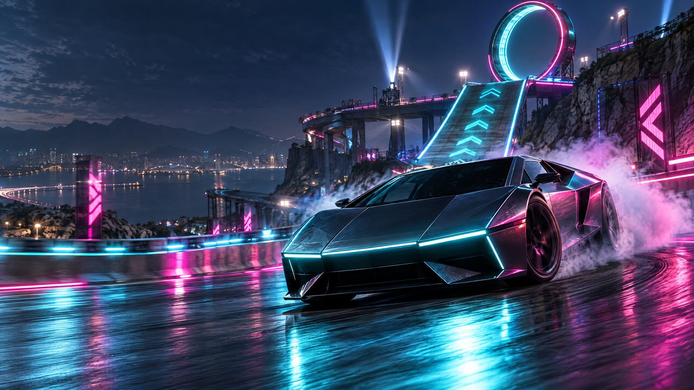
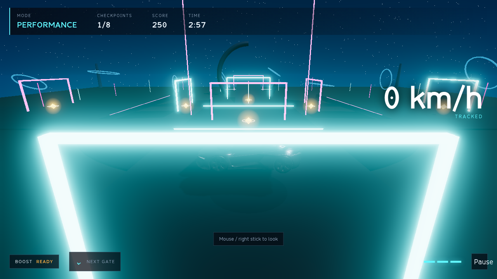
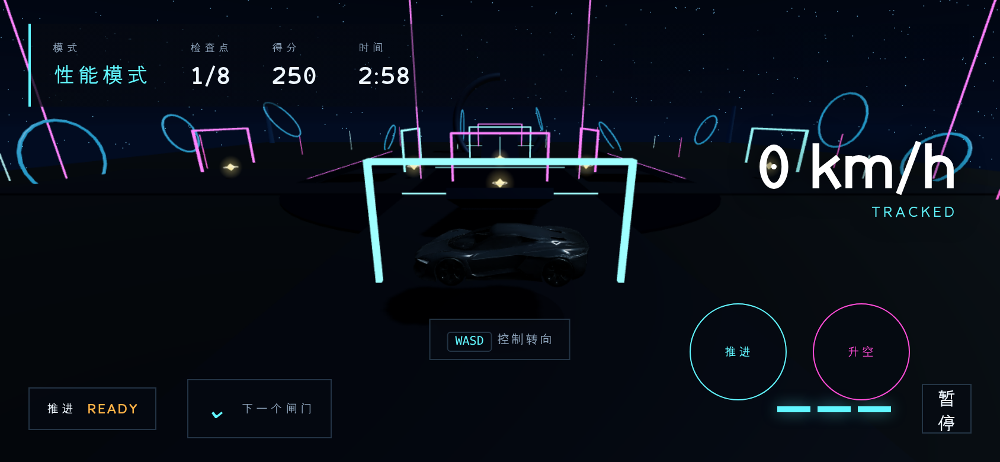

# Open Roadster Cars / 03

<p align="center">
  
</p>

<p align="center"><strong>A browser-first stunt-driving lab built around three radically different roadster identities.</strong></p>

<p align="center">
  <a href="https://roadsterstun-7achperf.manus.game"></a>
  <a href="LICENSE"></a>
  <a href="CONTRIBUTING.md"></a>
  <a href="https://threejs.org/"></a>
</p>

> **Open Roadster Cars** is an unofficial fan-made project. Tesla names, marks, product references and imagery belong to their respective owners. This project is not endorsed by Tesla.

## Play

The project is delivered as a static browser game and is designed for desktop Chrome, Android Chrome, iOS Safari/Chrome and future PC packaging.

**Live build:** [roadsterstun-7achperf.manus.game](https://roadsterstun-7achperf.manus.game)

**Local development**

```bash
pnpm install
pnpm dev
```

**Production verification**

```bash
pnpm test
pnpm build
pnpm smoke
```

The smoke flow covers the title screen, mode selection, driving, boost/lift, pause, settings, results, Chinese locale and landscape mobile HUD.

## The three identities

### Performance

A two-seat-inspired electric sports mode built around grip, high downforce and active aerodynamic wing cues. It is the cleanest route through the arena and rewards controlled line choice.

### Thrust

A two-seat-inspired experimental variant with rear cold-gas thruster cues and a short, high-energy burst. The sub-one-second 0–60 reference is presented as game fiction, not a verified road claim.

### Rocket

A single-seat-inspired experimental configuration with perimeter thruster cues, vertical lift and air steering. It is explicitly labelled as not approved for public roads inside the game.

## What makes the vertical slice feel like a game

- A closed-loop stunt arena with eight gates, ramps, a partial loop element and luminous route language.
- Fixed-step kinematic driving with coyote time, snap-to-ground, slope limits, safe recovery points and mode-specific air control.
- Airtime, checkpoint chains, combo scoring, lives, timer pressure, restart flow and local records.
- High-quality rendering with PBR materials, dynamic shadows, adaptive quality presets, selective bloom, fog, particles and camera shake.
- Keyboard, pointer lock, gamepad and touch controls with an accessible pause/settings flow.
- Original no-logo generated vehicle art plus a procedural fallback so the game remains playable if the managed model asset is unavailable.





## Technical foundation

- **Client:** TypeScript, Vite and Three.js.
- **Simulation:** Rapier kinematic character controller with a fixed-step game loop.
- **Rendering:** ACES tone mapping, PBR materials, dynamic shadows, quality tiers and optional Unreal Bloom.
- **Input:** keyboard, pointer lock, gamepad and touch abstraction through one input layer.
- **Persistence:** local settings, language, tutorial state and local leaderboard only; no account or server database.
- **Deployment:** static build output in `dist/`, with SPA-safe route metadata and share metadata.

The architecture deliberately keeps the game playable without a backend. That makes the project easy to fork, run and host from a static provider while leaving a clean seam for future online features.

## Repository map

```text
src/engine/       input, loop, physics, renderer, audio, save data
src/game/         vehicle controller, arena, rules, effects and world logic
src/ui/           menus, HUD, touch controls and localization
public/models/    runtime vehicle asset
assets.lock.json  managed asset provenance and restore metadata
docs/             provenance, review notes and README media
scripts/          build, asset restore and smoke verification helpers
```

## Asset and trademark boundary

This repository does **not** copy or redistribute Tesla product photographs. Renaming a Tesla photograph would not transfer copyright or trademark rights. Official Tesla pages are used as feature references only, and the in-game vehicle is an original unbranded asset with a procedural fallback.

Read [docs/ASSET-PROVENANCE.md](docs/ASSET-PROVENANCE.md) before adding any vehicle image, model, texture, sound or font. Every new asset must record its source, creator, license or restriction, attribution and whether it is committed or managed.

## Contributing

The project values playable improvements over ornamental complexity. Start with [CONTRIBUTING.md](CONTRIBUTING.md), keep changes focused, preserve mobile performance, add or update tests for rules changes and run all three verification commands before opening a pull request.

Good first contributions include new stunt-line layouts, mode-specific handling refinements, accessibility improvements, localization, performance profiling and original permissively licensed assets.

## Project status

This is a polished browser vertical slice, not a claim to be a full commercial AAA production. It is intentionally small enough to understand, fork and improve. The next high-value milestones are a second arena, replay ghosts, stronger audio feedback, deterministic performance telemetry and optional server-side competitive records.

## License

Original source code and project-authored material are released under the [MIT License](LICENSE). Third-party and generated assets may have separate terms; consult their provenance entries before mirroring or redistributing them.
